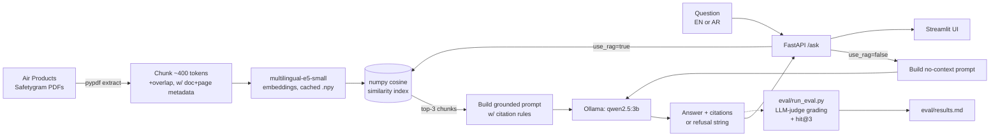

# Bilingual Gas Safety Assistant

A small bilingual (English/Arabic) RAG system that answers questions about
industrial gas safety using five public Air Products Safetygram PDFs, with an
automated hallucination/citation evaluation harness.

**Demo only, not for operational safety use.**

## Problem

Safety documentation (SDS/Safetygrams) is long, technical, and often needed in
more than one language. A chatbot that answers safety questions is only useful
if it (a) actually grounds its answers in the source documents, (b) cites
exactly where each claim came from, and (c) says "I don't know" instead of
inventing an answer when the documents don't cover the question. This project
builds that assistant end-to-end and then **measures** how well it does those
three things, comparing retrieval-augmented generation (RAG) against a plain
no-context baseline, in both English and Arabic.

## Architecture



## How to run

```bash
# 1. Install dependencies (Python 3.11)
pip install -r requirements.txt

# 2. Download the corpus (not committed to the repo)
python src/download_corpus.py

# 3. Chunk the PDFs
python -m src.ingest

# 4. Pull a local model with Ollama (https://ollama.com)
ollama pull qwen2.5:3b   # or qwen2.5:7b if your machine has >=16GB RAM

# 5a. Run the API
uvicorn app.main:app --reload
# -> POST http://localhost:8000/ask {"question": "...", "use_rag": true}
# -> GET  http://localhost:8000/health

# 5b. Run the UI (in another terminal, with the API running)
streamlit run app/streamlit_app.py

# 6. Run the evaluation
python -m eval.run_eval   # generates + grades eval/results.csv
python -m eval.report     # prints + saves eval/results.md
```

Or via the Makefile: `make install`, `make download-corpus`, `make ingest`,
`make run-api`, `make run-ui`, `make eval`, `make test`, `make lint`.

Config (model name, Ollama host, API URL) lives in environment variables —
see `.env.example`.

## Design choices worth noting

- **Model size**: the brief called for qwen2.5:7b with a fallback to
  qwen2.5:3b "if too slow." This machine has 7.8GB total RAM, not enough
  headroom to safely run the 7B model alongside the OS, so the 3B model was
  used from the start rather than discovered to be necessary after the fact.
- **Citations**: the LLM is instructed to emit `[document, page]` immediately
  after every factual sentence, copying the document name verbatim from the
  retrieved-chunk headers in the prompt. This works reliably in English;
  Arabic citation accuracy is measurably worse (see Limitations) because the
  3B model sometimes translates or garbles the document name instead of
  copying it literally.
- **Script purity for Arabic**: the Arabic prompts (RAG and no-RAG) explicitly
  instruct the model to write the answer body in Arabic script only, with the
  `[document, page]` citation brackets as the one allowed exception. The
  `script_leak` eval metric checks this automatically (see Results) -- the
  3B model still leaks Latin or CJK characters into some Arabic answers even
  with this instruction, which is reported as-is rather than hidden.
- **Judge determinism**: Ollama's default sampling temperature made the LLM
  judge non-deterministic -- grading the same answer twice could give
  different verdicts. All LLM calls (answering and judging) use
  `temperature=0.1`. The judge also needed a tolerant regex parser instead of
  strict JSON parsing, because the 3B model occasionally misspells its own
  output keys (e.g. `"hallinated"` instead of `"hallucinated"`).
- **Chunking**: ~400 tokens (cl100k_base) with 80-token overlap, computed per
  PDF page so every chunk keeps a single `(document, page)` tag.

## Results

See `eval/results.md` (generated by `eval/report.py`) for the full table,
reproduced below. Every rate is shown as `rate (count/total)`, not just a
bare fraction:

| lang | mode   |  n | accuracy     | hallucination_rate | citation_accuracy | refusal_accuracy_on_unanswerable | hit@3_exact_page | hit@3_page±1 | hit@3_doc   | script_leak_rate |
|:-----|:-------|---:|:-------------|:--------------------|:-------------------|:----------------------------------|:------------------|:--------------|:------------|:------------------|
| ar   | RAG    | 10 | 0.400 (4/10) | 0.300 (3/10)        | 0.000 (0/6)         | 1.000 (4/4)                       | 0.500 (3/6)       | 0.500 (3/6)   | 1.000 (6/6) | 0.300 (3/10)      |
| en   | RAG    | 10 | 0.600 (6/10) | 0.300 (3/10)        | 0.333 (2/6)         | 1.000 (4/4)                       | 0.333 (2/6)       | 0.667 (4/6)   | 1.000 (6/6) | n/a               |
| ar   | no-RAG | 10 | 0.000 (0/10) | 1.000 (10/10)       | 0.000 (0/6)         | 0.000 (0/4)                       | n/a               | n/a           | n/a         | 0.000 (0/10)      |
| en   | no-RAG | 10 | 0.200 (2/10) | 0.800 (8/10)        | 0.000 (0/6)         | 0.000 (0/4)                       | n/a               | n/a           | n/a         | n/a               |

The headline result, in counts rather than multipliers: RAG cuts
hallucinated answers from 10/10 to 3/10 in Arabic and from 8/10 to 3/10 in
English, and raises accuracy from 0/10 to 4/10 (Arabic) and 2/10 to 6/10
(English). RAG is also the only mode that ever correctly refuses an
unanswerable question -- 4/4 in both languages, vs 0/4 for no-RAG, which
never once said "I don't know" and always fabricated an answer.

Citation accuracy stays low (0/6 Arabic, 2/6 English) and retrieval quality
depends heavily on how strictly it's measured: requiring the exact gold page
is a 2/6-3/6 hit rate, loosening to "within one page of gold, same document"
helps English more than Arabic (2/6 -> 4/6 vs 3/6 -> 3/6), and just requiring
the correct document is a clean 6/6 for both languages -- i.e. retrieval
almost always finds the right document, but page-level precision within that
document is the weak point (see Limitations). `script_leak_rate` -- a new
check for non-Arabic (Latin/CJK) characters leaking into the body of an
Arabic answer, outside citation brackets -- shows the explicit "Arabic
script only" prompt rule (see Design choices) still isn't fully reliable on
this model: 3/10 Arabic RAG answers leak script, vs 0/10 in no-RAG mode
(citations, which are always in Latin script by design, are only present in
RAG answers, and that's the likeliest source of the leakage).

Methodology: 20 questions (10 English + their Arabic translations), 6 of each
10 answerable from the corpus and 4 deliberately not, each run through both
RAG and no-RAG modes against qwen2.5:3b (40 generations total). `correct` and
`hallucinated` are decided by an LLM-judge call (same model) for answerable,
non-refused answers; refusal/non-refusal on unanswerable questions is checked
deterministically against the exact refusal string. `citation_correct` checks
whether a `[document, page]` citation matches the gold document/page.
`hit@3_exact_page`, `hit@3_page±1`, and `hit@3_doc` all require the top-3
retrieved chunks to include one from the gold document, and differ only in
how close the page must be (exact page / within 1 page / any page) -- they
form a strict hierarchy (exact ⊆ page±1 ⊆ doc) and are restricted to
answerable questions in RAG mode. `script_leak` flags Latin/CJK characters
outside `[...]` citations in Arabic answers. 10 rows are left for manual
audit in the `human_check` column of `eval/results.csv`.

## Limitations

- Evaluated on a 3B-parameter local model on CPU-only hardware; a larger
  model would likely score higher on correctness and citation accuracy.
- The LLM-judge is the same small model doing the grading, which is a known
  source of judge bias/noise -- treat the numbers as directionally useful,
  not as a certified benchmark. The `human_check` column exists precisely so
  a person can spot-check a sample.
- The corpus is 5 PDFs (85 chunks). Retrieval quality has not been stressed
  with a larger or noisier corpus.
- Citation format compliance is noticeably weaker in Arabic than English for
  this model size (see Design choices above), which is reflected in the low
  citation_accuracy numbers.
- Document-level retrieval is reliable (`hit@3_doc` is 6/6 in both languages)
  but page-level precision within the right document is the weak point:
  `hit@3_exact_page` is only 2/6-3/6. Looking at `eval/results.csv`, several
  misses are near-misses: the gold page was hand-labeled as the single page
  with the clearest statement of the answer, but the retriever's top-3
  chunks often land on an adjacent page of the same document that also
  discusses the topic. Page-granularity chunking makes single-gold-page
  labeling an imperfect ground truth, not necessarily a pure retrieval
  failure.
- The explicit "Arabic script only" prompt rule reduces but does not
  eliminate script leakage: `script_leak_rate` is still 3/10 for Arabic RAG
  answers (citations force a Latin-script document name into the answer,
  which appears to be the main vector for further leakage into the
  surrounding Arabic text).
- No conversation memory -- each question is answered independently.

**Demo only, not for operational safety use.**
